# Mentorensuche

Werbeseite im Python-Stil: angehende Fachinformatikerin Anwendungsentwicklung sucht Mentor:in.

| Datei | Beschreibung |
| --- | --- |
| [`variante-a.html`](variante-a.html) | Verfeinert – drei Farbkarten mit Python-Codeblöcken, Kontakt-Button |
| [`variante-b.html`](variante-b.html) | Editor-Fenster – Titelleiste `mentor_gesucht.py`, Zeilennummern, Statusleiste |

Beide Seiten sind responsiv und nutzen die Schrift Inconsolata aus `assets/`.

`mentor_gesucht.svg` ist Variante B als animiertes Bild für READMEs (Schrift und Bild eingebettet).
Neu erzeugen nach Textänderungen: `python tools/build_svg.py` (benötigt Pillow und fontTools).
